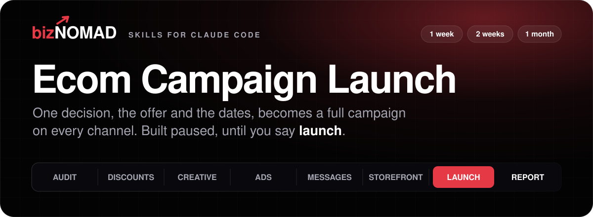
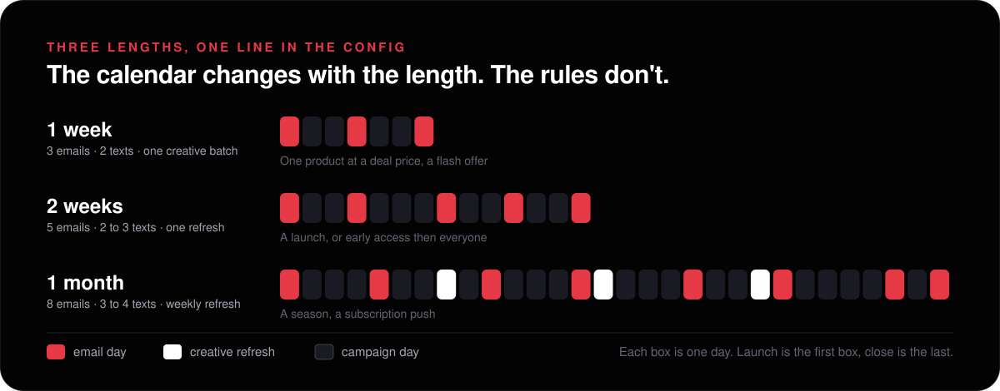
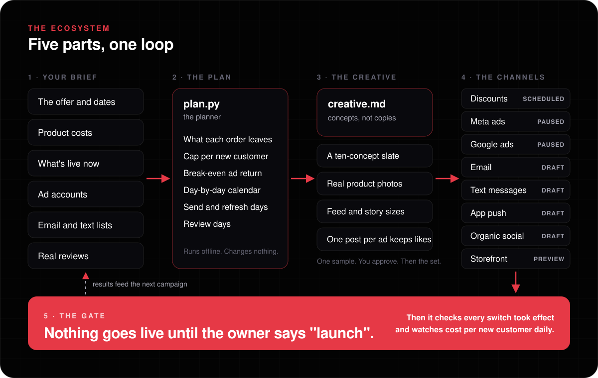
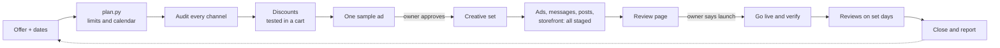

<p align="center">
  
</p>

<p align="center">
  
  
  
  
  
</p>

<h3 align="center">One decision in. A full campaign out.</h3>

<p align="center">
Tell Claude the offer and the dates. It audits every channel, does the money math, builds the discounts, ads,<br>
emails, texts, posts and storefront, and waits. Nothing goes live until you say <b>launch</b>.
</p>

<p align="center">
  <a href="#quick-start">Quick start</a> ·
  <a href="#three-lengths">Three lengths</a> ·
  <a href="#what-it-can-do">What it can do</a> ·
  <a href="#the-ecosystem">The ecosystem</a> ·
  <a href="#the-plan-it-prints">Sample plan</a> ·
  <a href="#safety-rules">Safety rules</a>
</p>

---

## Quick start

```bash
git clone https://github.com/Biznomad/ecom-campaign-launch ~/.claude/skills/ecom-campaign-launch
```

Then, in Claude Code, inside your store's project:

```
/ecom-campaign-launch
```

or say **"plan a 2-week campaign"**. Claude copies the example config, asks only for what it can't look up, and shows you the plan before it builds anything.

Want to see a plan first, with no store connected?

```bash
cd ~/.claude/skills/ecom-campaign-launch
python3 scripts/plan.py campaign.config.example.json
```

The planner runs offline, needs no packages and changes nothing.

## Three lengths

<p align="center">
  
</p>

Set `"duration"` to `1w`, `2w` or `1m` in the config.

| | 1 week | 2 weeks | 1 month |
|---|---|---|---|
| **Best for** | One product at a deal price, a flash offer | A launch, or early access then everyone | A season, a subscription push |
| **Emails** | 3: opening, mid-week, last day | 5: opening, proof, new angle, 3 days left, last day | 8: one or two a week, plus opening and closing |
| **Texts** | 2: open, ends tonight | 2 to 3 | 3 to 4 |
| **Ad creative** | One batch | One refresh at day 7 | Refresh weekly |
| **Reviews of results** | Day 3 and day 5 | Twice a week | Weekly, plus day 3 |
| **Urgency** | A real end date | A second "opening" at the midpoint | Monthly themes, not a countdown |

## What it can do

| | Capability | How |
|---|---|---|
| 🔎 | **Audits before it builds** | Reads what is live, scheduled or in conflict on every channel: old codes that stack, a promo still running, an unpaid bill pausing sends |
| 💵 | **Shows what every order leaves you** | Price minus product cost, shipping and payment fees, for each offer |
| 🎯 | **Gives you a spending limit** | The most you can pay for a new customer and the break-even return on ad spend. Subscriptions are judged over two orders |
| 📅 | **Prints a dated calendar** | Every email, text, push, post, creative refresh and review day for the length you chose |
| 🏷️ | **Builds the discounts** | Automatic discounts for the exact products and window, tested in a real cart |
| 🎨 | **Plans creative as concepts** | A ten-concept slate, one sample for approval, then the set, from real product photos |
| 📣 | **Stages the ads** | One new-customer and one retargeting ad set, paused. One post per ad, reused, so likes and comments carry over |
| ✉️ | **Drafts every message** | Email, text and push as drafts, with a safe order for scheduling |
| 🛒 | **Stages the storefront** | Hero, product page and cart on a preview theme, walked on a phone with the cart read after every tap |
| 🔒 | **Waits for you** | One review page with every asset, link and price. It flips nothing until you say "launch" |
| 🩺 | **Diagnoses a drop** | A six-step check that tells a traffic change from a broken page before you spend more |
| 🧾 | **Closes and reports** | Confirms discounts ended and ads stopped, restores the theme, reports against the limit |

## The ecosystem

<p align="center">
  
</p>

The skill is small on purpose. It is a conductor: a planner and six playbooks that put Claude, your accounts and your tools to work in the right order.

### What ships in this repo

| Piece | Job |
|---|---|
| [`SKILL.md`](SKILL.md) | The ten-step run and the rules that never bend |
| [`scripts/plan.py`](scripts/plan.py) | What each order leaves, the spending limit, break-even return, the dated calendar |
| [`references/cadence.md`](references/cadence.md) | What changes between 1 week, 2 weeks and a month. Launch-day order. Close-out |
| [`references/creative.md`](references/creative.md) | Concepts over copies, the ten-concept slate, image checks |
| [`references/ads.md`](references/ads.md) | Account structure, keeping likes and comments on ads, daily checks |
| [`references/messaging.md`](references/messaging.md) | Email, text and push: what to check, build order, safe sending |
| [`references/diagnose.md`](references/diagnose.md) | Finding the cause when sales or add-to-cart drop |
| [`references/traps.md`](references/traps.md) | Platform quirks that cost a retry |

### What it connects to, with your access

Your store, your ad accounts, your email and text platform, your reviews app and whatever image tools you use. The skill holds no keys and no connectors of its own. Claude works through the access you have already given it, and the rules say credentials are never printed or copied.

### Its sibling

[`bfcm-campaign-launch`](https://github.com/Biznomad/bfcm-campaign-launch) is the Black Friday / Cyber Monday fork. It starts the day you install it, plans every day through Cyber Monday, sets offers from your store's data and picks the best image tool on your machine for each ad. Use this skill the rest of the year; the concepts that win here are the ads you start November with.

### How a run flows



## The plan it prints

<details open>
<summary><b>Example: 1-week campaign, made-up store</b></summary>

```text
Example Brand: Spring Stock-Up (1w, 7 days from 2027-03-01)

Money left per order before ads
  Single           price $25.00  left $12.97  max cost per new customer $12.97  break-even return 1.93x
  Bundle of 3      price $66.00  left $40.79  max cost per new customer $40.79  break-even return 1.62x
  Subscription     price $62.00  left $36.90  max cost per new customer $89.34  (pays back by order 2; each renewal leaves $52.44)

Ad budget $100 a day, $700 for the campaign

Calendar
  Mon 2027-03-01
     - Launch: flip ads, publish theme, confirm discounts are live in a real cart
     - Email: opening
     - Organic post (approved slots only)
  Wed 2027-03-03
     - Organic post (approved slots only)
     - Review: sales, ad spend, new customers, cost per new customer vs cap
  Thu 2027-03-04
     - Email: reminder / new angle
  Fri 2027-03-05
     - Organic post (approved slots only)
     - Review: sales, ad spend, new customers, cost per new customer vs cap
  Sun 2027-03-07
     - Email: last day
     - Organic post (approved slots only)
     - Close at 23:59: discounts end, ads stop, theme restored, results report
```

</details>

Add `--json` to feed the plan to another tool.

## Safety rules

These hold on every run. They are in [`SKILL.md`](SKILL.md), where Claude reads them first.

- **Staged, not live.** Ads are created paused. Emails, texts and posts are drafts. Store changes go on a preview theme.
- **You launch it.** The owner's word "launch" is the only thing that flips anything on.
- **No spend surprises.** It reads billing status and today's spend before any switch, and never raises a budget without your number.
- **Safe sends.** A send time is saved and read back before any send job starts.
- **Honest claims only.** Your exact offer and terms. No health claims, no invented reviews, no dates baked into images.
- **Keys stay put.** Credentials are never printed and never copied between businesses.
- **It tells you what failed.** A step that was skipped or broke is reported as such.

## What you need

- [Claude Code](https://claude.com/claude-code), with access to your store, ad accounts and email platform.
- Python 3 for the planner.

## Good to know

- The ad and creative guidance comes from agency practice, not platform rules. Your own account's results should overrule it.
- The planner is tested at all three lengths. A full run on your store depends on the access you give Claude.
- The example config uses made-up numbers. Put in your own before trusting any figure.

---

<p align="center">
  <b>bizNOMAD</b> · Small Business Hero<br>
  <sub>Built by <a href="https://biznomad.io">Biznomad</a> for store owners who want an agency's process without the agency. MIT licensed.</sub>
</p>
